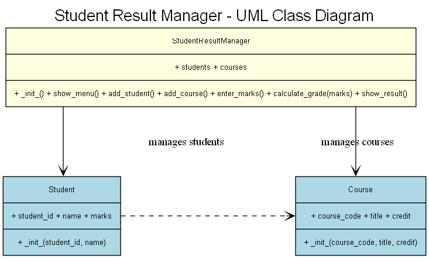

# Student Result Manager

## Project Description

Student Result Manager is a Python-based application designed to manage student information, course details, marks, grades, and CGPA.

## Features

- Add Student
- Add Course
- Enter Marks
- Calculate Letter Grade and Grade Point
- Calculate CGPA
- Show Student Result Sheet

## Technologies Used

- Python
- Graphviz

## Project Files

- main.py
- test_project.py
- uml_diagram.py
- Student_Result_Manager_UML.png
- README.md

## How to Run

python main.py

## How to Run Tests

python -m unittest test_project.py -v

## UML Diagram

